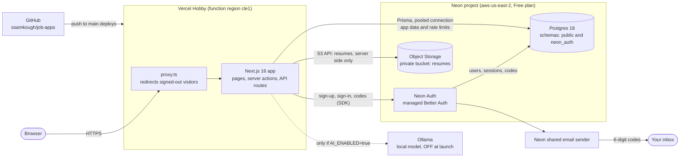
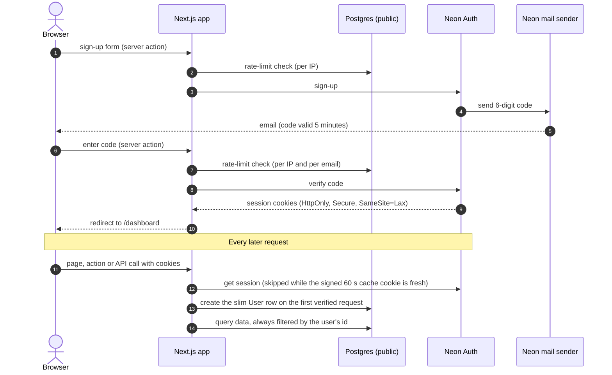
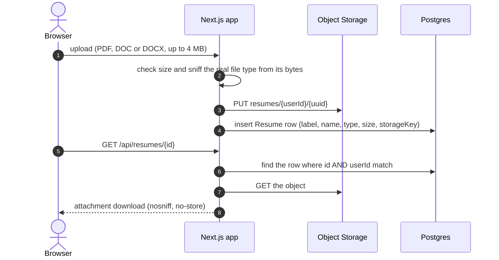
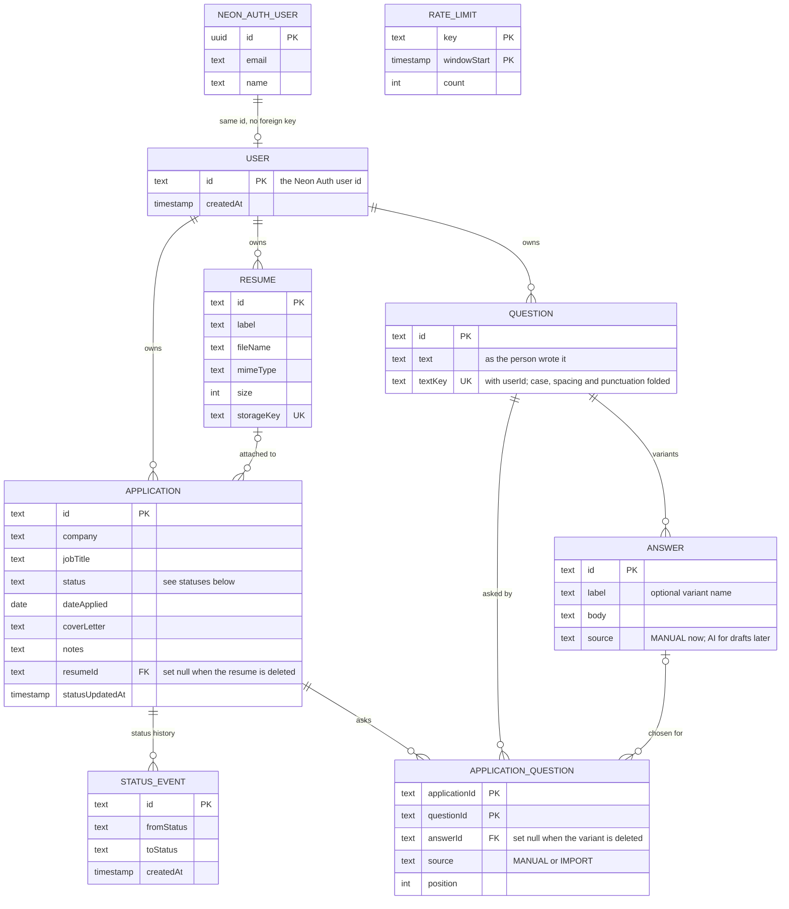

# Job Application Helper

Track every job application in one place: status, the resume you sent, an
optional AI-assisted cover letter, dates, notes, contacts, and dashboard
insights. Email/password accounts with a verification code at sign-up and
password reset by emailed code.

**Stack:** Next.js 16 (App Router) · React 19 · TypeScript · Tailwind v4 ·
[Neon](https://neon.com) Postgres via Prisma · [Neon Auth](https://neon.com/docs/auth/about.md)
(managed Better Auth, through our own forms and server actions) ·
Neon Object Storage (S3-compatible) for resumes · Ollama (local model, off by
default) for cover letters. Hosted on Vercel; see [DEPLOYMENT.md](./DEPLOYMENT.md).

> This repo uses a newer Next.js than most training data. Before changing
> framework code, read the matching guide in `node_modules/next/dist/docs/`.

## How it works

*State as of Nov 2026 (the launch configuration: AI off, everything in the cloud).*

### The pieces



The browser only ever talks to Vercel. Neon Auth, Postgres and Object Storage
are reached from the server, and the app deliberately does **not** expose Neon
Auth's own endpoints (`/api/auth` is a 404). Resumes are never public: the
bucket is private and files are streamed through the authenticated route
`/api/resumes/[id]`.

### Sign-up, verification and every request after it



Signed-out visitors are redirected by `proxy.ts`, but that is only a
convenience: every page, server action and API route checks the user itself
(`requireUser`), and anything sensitive (password change, account deletion)
uses `requireFreshUser`, which skips the 60 s cache.

### Resume upload and download



The 4 MB cap exists because Vercel rejects request bodies over 4.5 MB.

### The data

Two kinds of data live in the same Neon Postgres database, in different schemas:

| Where | What | Who owns it |
| --- | --- | --- |
| `neon_auth` schema | Users (email, name, password hash), sessions, verification codes | Neon Auth. The app never writes here |
| `public` schema | `User` (just the Neon Auth user id), `Application`, `StatusEvent`, `Resume`, `Question`, `Answer`, `ApplicationQuestion`, `ImportJob`, `RateLimit` | This app, via Prisma migrations |
| Object Storage bucket `resumes` | The resume files, keyed `{userId}/{uuid}` | This app, through one S3 credential |
| Browser cookies | `__Secure-neon-auth.*`: the session token and a signed 60 s session cache | Set by the Neon Auth SDK |



(`RateLimit` stands alone: it holds counters keyed by IP, email or user id.
`Application` also stores the job URL, location, work type, salary, source,
description, contact name and contact email; they are left out of the diagram
for space.)

Deleting a `User` cascades to their applications, resumes and status history.
Deleting a `Resume` keeps the applications that used it.

**Questions.** A `Question` is something application forms ask ("Why do you
want to work here?"). It belongs to one person, can be attached to many
applications, and an application can have many questions (the
`ApplicationQuestion` join table, which also records which `Answer` variant was
chosen for that application). A question has any number of answer variants.
Two spellings of one question ("Why us?" / "why us") resolve to a single row
through `textKey`, so variants are never split. Deleting an application or a
variant keeps the question; deleting a question removes it from every
application; deleting an account removes all of it. `Answer.source` is the seam
for drafting answers with the local model later (not built yet).

**How the importer works** is drawn in [`docs/import-architecture.md`](docs/import-architecture.md) (kept current by a Cursor rule).

**Finding questions when importing a posting.** The importer looks for the
questions a posting's application asks and offers them to add (never adds them
on its own): Greenhouse boards through Greenhouse's public board API, Lever
postings through their apply page, and any other page through the labelled
fields of a form that looks like an application. Contact and demographic
fields are left out. It is best effort: sites that render their form with
JavaScript (e.g. Ashby, Workday) show none, and a failure never fails the
import.

**Statuses:** `WISHLIST` → `APPLIED` → `SCREENING` → `INTERVIEWING` → `OFFER` →
`ACCEPTED`, plus `REJECTED` and `WITHDRAWN`. An active application (applied,
screening, interviewing or offer) with no status change for **14 days** is
flagged as stale on the dashboard.

**Rate limits** (Postgres fixed windows, no Redis):

| Action | Limit |
| --- | --- |
| Sign-up | 5 per hour per IP |
| Sign-in | 20 per 15 min per IP, and 10 failures per 15 min per email |
| Send a code | 15 per hour per IP, and 4 per hour per email |
| Submit a code | 20 per 15 min per IP, and 10 per 15 min per email |
| Password check (change password, delete account) | 10 per 15 min per user |
| AI cover letter (when enabled) | 15 per hour per user |

**Free-tier ceilings that matter** (details and caveats in
[DEPLOYMENT.md](./DEPLOYMENT.md#free-tier-limits)): Neon Free gives 100
compute-hours, 1 GB of Postgres and 5 GB of storage a month, and the database
sleeps after 5 idle minutes, so the first request after a nap is slow. Vercel
Hobby is for personal, non-commercial use.

### Services

| Service | What it does here | Link |
| --- | --- | --- |
| GitHub | Source code (public repo) and the trigger for deploys | [ssamkough/job-apps](https://github.com/ssamkough/job-apps) |
| Vercel | Hosts the app (Hobby plan) | [vercel.com](https://vercel.com) · [docs](https://vercel.com/docs) · [regions](https://vercel.com/docs/regions) · [fair use](https://vercel.com/docs/limits/fair-use-guidelines) |
| Neon | One project holds Postgres, Auth and Object Storage | [Console](https://console.neon.tech) · [docs](https://neon.com/docs) · [plans](https://neon.com/docs/introduction/plans.md) |
| Neon Postgres | App data, rate limits and the `neon_auth` schema | [docs](https://neon.com/docs) |
| Neon Auth | Accounts, sessions, emailed codes (managed Better Auth) | [docs](https://neon.com/docs/auth/about.md) · [Next.js SDK](https://neon.com/docs/auth/reference/nextjs-server.md) · [troubleshooting](https://neon.com/docs/auth/troubleshooting.md) |
| Neon Object Storage | The private `resumes` bucket (S3-compatible) | [buckets](https://neon.com/docs/storage/buckets.md) · [credentials](https://neon.com/docs/storage/authentication.md) |
| Neon shared email sender | Sends the verification and reset codes from `auth@mail.myneon.app` | [email verification](https://neon.com/docs/auth/guides/email-verification.md) |
| Prisma | Database client and migrations | [prisma.io](https://www.prisma.io/docs) |
| Ollama (off) | Local model for AI cover letters, only when `AI_ENABLED=true` | [ollama.com](https://ollama.com) |
| Uptime monitor (optional) | Not set up yet; see the interval advice in DEPLOYMENT.md | [DEPLOYMENT.md](./DEPLOYMENT.md#operations) |

## Run it locally

Prerequisites: Node 20.9+ (developed on Node 24), a local PostgreSQL, and a
**Neon project with Auth enabled** (a development branch is fine, the free plan
covers it). Optional: [Ollama](https://ollama.com) for AI drafts.

```bash
npm install
cp .env.example .env              # then fill in the values below
createdb jobapps_dev              # or use any Postgres you like
npx prisma migrate deploy         # applies prisma/migrations
npm run dev                       # http://localhost:3000
```

What `.env` needs to run `npm run dev`:

| Variable | Local value |
| --- | --- |
| `DATABASE_URL`, `DIRECT_URL` | Your local Postgres (the `.env.example` defaults work with `createdb jobapps_dev` if the `jobapps` role exists) |
| `NEON_AUTH_BASE_URL` | The **Auth URL** of a Neon branch: Console → project → branch → Auth → Configuration |
| `NEON_AUTH_COOKIE_SECRET` | Any random string of 32+ characters (`openssl rand -base64 32`) |
| `STORAGE_DRIVER` | `local` (default): resumes are written under `./data/uploads` |

How authentication works in development: **there is no local stand-in for Neon
Auth.** `npm run dev` talks to the real Neon Auth service of whatever branch
`NEON_AUTH_BASE_URL` points to. Users, passwords, sessions and verification
codes live there (in that branch's `neon_auth` schema); only a slim `User` row
(its id) is created in *your* database, on the user's first signed-in request.

- Use a **development branch**, not the production one. Development branches
  keep **Allow localhost** on (its default), which trusts any `localhost`
  origin. If sign-up fails with an "origin" error, that setting or the trusted
  domains are the cause ([troubleshooting](https://neon.com/docs/auth/troubleshooting.md)).
- **Emails are real.** Verification and reset codes are emailed by Neon's shared
  sender (`auth@mail.myneon.app`), so use an address you can read. Nothing is
  printed in the terminal. The sender's rate limit is undocumented, so don't
  hammer sign-up.
- The e2e suite's mock (`e2e/mock-neon-auth.mjs`) is built for the test server
  on port 3100 and accepts only that origin. Pointing a manual `npm run dev`
  session at it is not a supported or tested path.
- **AI drafts (off by default):** set `AI_ENABLED="true"` in `.env`, then
  `ollama pull qwen3.8:27b` (or set `OLLAMA_MODEL` to any model you have). With
  the flag off the "Write with AI" button is hidden, `/api/cover-letter`
  returns 404, and the cover letter is just a textarea. Drafts need a verified
  email address. A local model takes a minute or two per letter.
- **Dev test account:** put `Email:`, `Password:` and optional `Name:` lines in
  `.test-account.local` (gitignored; never commit it), then run
  `node --env-file=.env scripts/create-test-account.mjs --allow-host <your Neon Auth host>`.
  It signs up through Neon Auth's HTTP API and then needs the **6-digit code
  emailed to that address**: Neon Auth offers no supported way to skip
  verification, and the script doesn't pretend otherwise. It prompts for the
  code (or accept `--code 123456`), refuses to run when `NODE_ENV=production`,
  and refuses unless `--allow-host` exactly matches the host in
  `NEON_AUTH_BASE_URL` (so it can't hit production by accident; use a dev
  branch). Details are in the header of the script.

## Quality checks

```bash
npm run typecheck
npm run lint
npm test            # unit + integration (Vitest, real Postgres `jobapps_test`)
npm run test:e2e    # builds, then Playwright against the production build
```

First-time setup for tests:

```bash
psql postgres -c 'CREATE DATABASE jobapps_test' -c 'CREATE DATABASE jobapps_e2e'
npx playwright install chromium
```

`npm test` and the e2e run only ever touch databases named `*_test` / `*_e2e`
(the scripts refuse anything else). Neither needs a Neon account or network:

- **Unit/integration tests** replace the auth backend with an in-memory fake
  (`src/test/fake-auth.ts`).
- **The e2e run** starts `e2e/mock-neon-auth.mjs` (a stand-in for Neon Auth on
  `127.0.0.1:11502`, modelled on behavior checked against a real Neon branch)
  and `e2e/mock-services.mjs` (a mock Ollama). The mock exposes the emailed
  codes to the tests, so sign-up, verification and password reset run offline.
  It is a model, not the real service: the real Neon Auth is only covered by the
  manual smoke test in [DEPLOYMENT.md](./DEPLOYMENT.md#go-live).
- Run `E2E_AI=false npm run test:e2e` to test the no-AI launch configuration
  (the AI specs skip; a check that the AI UI is gone runs instead). It also
  writes mobile screenshots to `e2e/screenshots/`.

## Where things live

| Path | What |
| --- | --- |
| `src/proxy.ts` | Redirects signed-out visitors from app pages to `/login` and refreshes the SDK's session cache cookie. Not the security boundary: pages and actions check the user themselves |
| `src/app/actions/` | Server actions: auth, account, applications, resumes. Every export here is a public endpoint, so shared helpers live in `src/lib/`, not here |
| `src/app/api/` | `cover-letter` (AI), `resumes/[id]` (authenticated download proxy), `health` |
| `src/app/(auth)/` | Login, signup, verify-email (code), forgot/reset password pages |
| `src/lib/neon-auth.ts` | Creates the Neon Auth SDK (reads `NEON_AUTH_BASE_URL`, `NEON_AUTH_COOKIE_SECRET`; session cache 60 s, SameSite lax) |
| `src/lib/auth-api.ts` | The one door to Neon Auth: a small `AuthApi` interface over the SDK, returning `{ data, error }` |
| `src/lib/auth-error-map.ts`, `auth-errors.ts` | Translate the SDK's error codes into ours; user-facing messages for unexpected failures |
| `src/lib/auth-cookies.ts` | Detects and clears Neon Auth cookies (sign-out works even if Neon Auth is down) |
| `src/lib/auth.ts` | `getCurrentUser` / `requireUser` / `requireFreshUser` and lazy creation of the slim `User` row |
| `src/lib/rate-limit.ts` | Postgres-backed fixed-window limiter (no Redis) |
| `src/lib/ai.ts` | Ollama client with a concurrency queue and timeouts |
| `src/lib/features.ts` | Feature flags (`AI_ENABLED`) |
| `src/lib/questions.ts`, `question-store.ts` | Question text rules, limits and form parsing; the store that attaches questions and variants to applications, always scoped to the owner |
| `src/lib/import/` | Posting importer: safe fetcher, JSON-LD and PDF readers, question finders (`questions.ts`), import jobs and the queue seam |
| `src/lib/storage.ts` | Resume storage (local disk or S3-compatible) and upload validation |
| `src/lib/validation.ts`, `constants.ts` | Form schemas; limits such as the 4 MB resume cap |
| `src/lib/file-type.ts`, `resume-text.ts` | Resume type sniffing from file bytes; text extraction (PDF, DOCX) for AI drafts |
| `src/lib/insights.ts`, `format.ts`, `form-state.ts`, `site.ts`, `db.ts` | Dashboard insights; date/size formatting; shared form-state type; site name and `SUPPORT_EMAIL`; the Prisma client |
| `src/test/` | Test helpers: in-memory fake auth, DB helpers, file fixtures |
| `e2e/` | Playwright specs and the offline mocks (`mock-neon-auth.mjs`, `mock-services.mjs`) |
| `prisma/` | Schema and migrations (app tables only; Neon Auth owns the `neon_auth` schema) |
| `scripts/backup-db.sh` | `pg_dump` backup with rotation |
| `scripts/create-test-account.mjs` | Dev test account against a (non-production) Neon Auth |

## The `AI_ENABLED` flag

AI cover letters are **off unless `AI_ENABLED` is exactly `"true"`**. Off means
no button, a 404 from `/api/cover-letter`, and privacy/terms pages that don't
mention AI. Production launches with it unset.

## Deploying

See [DEPLOYMENT.md](./DEPLOYMENT.md): the Vercel Hobby + Neon (Postgres, Auth,
Object Storage) runbook, with the
[free-tier limits](./DEPLOYMENT.md#free-tier-limits) (checked Nov 2026), the
[environment variable table](./DEPLOYMENT.md#environment-variables), the
[go-live steps and smoke test](./DEPLOYMENT.md#go-live),
[operations](./DEPLOYMENT.md#operations) (monitor, backups, rotating secrets)
and [known limitations](./DEPLOYMENT.md#known-limitations).
