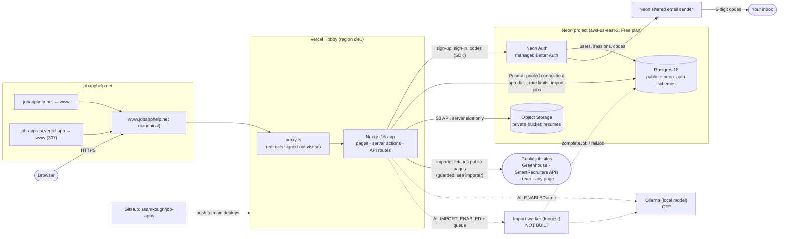
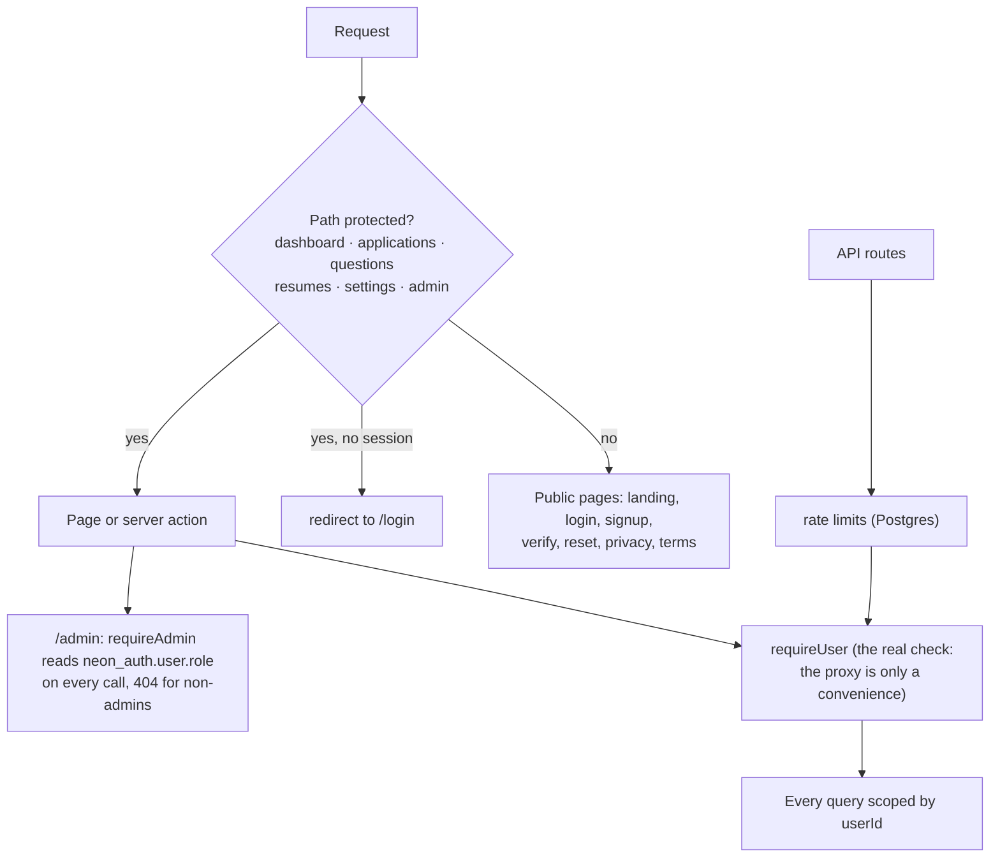
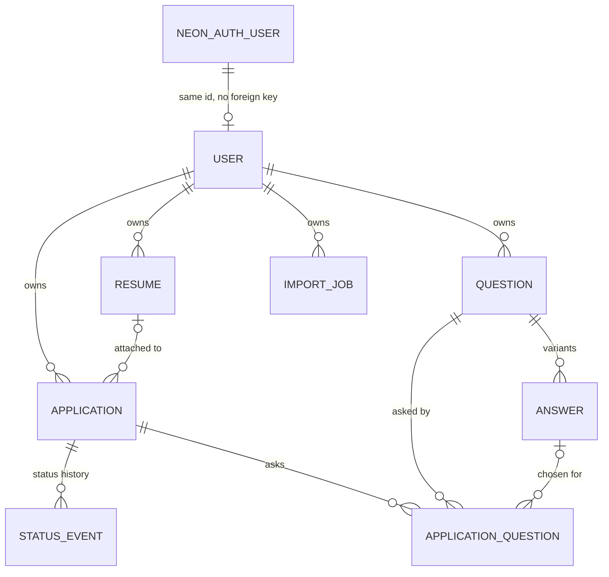
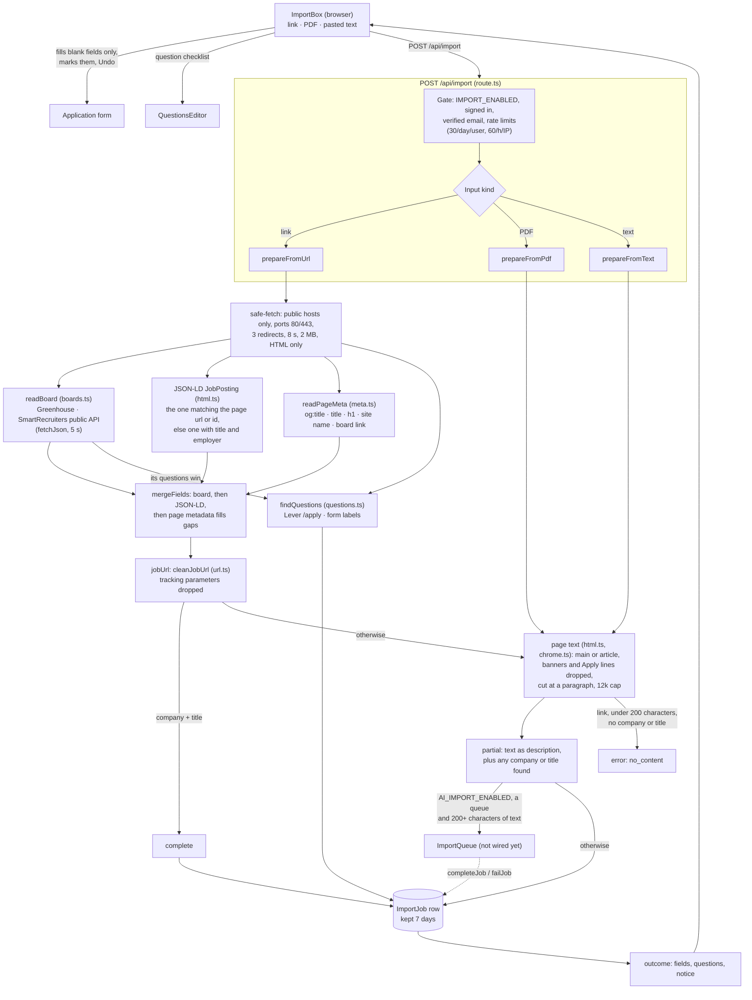

# Architecture

> **Keep this file current.** Any change to how the system is built or wired
> updates the diagrams, tables and changelog below **in the same commit**: a new
> or removed service, route, table, flag, rate limit, environment, deploy step
> or integration, as well as anything in the job posting importer. The Cursor
> rule `.cursor/rules/architecture.mdc` reminds you. (The file keeps its old
> name, `import-architecture.md`, because the importer was documented first.)

Contents: [System](#system) · [Requests and access](#requests-and-access) ·
[Data](#data) · [Flags, limits and environments](#flags-limits-and-environments) ·
[Job posting importer](#job-posting-importer) · [Planned, not built](#planned-not-built) ·
[Changelog](#changelog)

## System

Dotted edges and "OFF" / "NOT BUILT" boxes are designed but not running. The
browser only ever talks to Vercel; Neon is reached from the server, and the
app does not expose Neon Auth's own endpoints (`/api/auth` is a 404).

## Requests and access

| Area | Routes |
| --- | --- |
| App (signed in) | `/dashboard`, `/applications` (+ `/new`, `/[id]`), `/questions` (+ `/[id]`), `/resumes`, `/settings`, `/admin` |
| Auth | `/login`, `/signup`, `/verify-email`, `/forgot-password`, `/reset-password` |
| Public | `/`, `/privacy`, `/terms` |
| API | `/api/health`, `/api/resumes/[id]` (streams private files), `/api/cover-letter`, `/api/import`, `/api/import/[id]` |

Sessions are cookies on one host (`www.jobapphelp.net`); Neon Auth owns
accounts, the app keeps only the user id in `public."User"`. Security headers
(CSP, HSTS, frame denial) are set in `next.config.ts`.

## Data

`RateLimit` (counters keyed by IP, email or user id) stands alone. Full column
lists are in `prisma/schema.prisma` and the README's data section.

- Deleting a user cascades to everything they own. Deleting a resume keeps the
  applications that used it. Deleting an answer keeps the question and clears
  the choice. Deleting a question removes it from every application.
- **Migrations are applied by hand** (not by the Vercel build): dry run on a
  throwaway Neon branch, then apply, **before** deploying code that needs them.
  See `DEPLOYMENT.md`. Never `migrate reset`.
- Resume files live in the private Object Storage bucket, keyed `{userId}/{uuid}`.

## Flags, limits and environments

| Flag | Effect | Production |
| --- | --- | --- |
| `AI_ENABLED` | AI cover letters via Ollama | off |
| `IMPORT_ENABLED` | "Import from a job posting" and the question finder | on |
| `AI_IMPORT_ENABLED` | Sends text-only imports to the AI worker (needs `IMPORT_ENABLED` and a queue) | off, no queue |

| Rate limit (Postgres-backed) | Limit |
| --- | --- |
| Sign-in | 20 / 15 min per IP; 10 failures / 15 min per email |
| Sign-up | 5 / hour per IP |
| Emailed codes | 15 / hour per IP; 4 / hour per email; code guesses 20 / 15 min per IP, 10 / 15 min per email |
| Password re-check | 10 / 15 min per user |
| AI cover letter | 15 / hour per user |
| Imports | 30 / day per user; 60 / hour per IP; AI imports 10 / day per user |

| Environment | Where |
| --- | --- |
| Production | Vercel Hobby, Neon production branch (`DATABASE_URL` pooled, `DIRECT_URL` for migrations) |
| Local dev and tests | local Postgres (`jobapps_dev`, `jobapps_test`), mock Neon Auth and mock services for e2e |

## Job posting importer

The importer turns a link, a PDF or pasted text into values for the Add
application form, and finds the questions the application asks. Everything runs
on the server in `POST /api/import`; the browser only fills in blank fields and
offers Undo.

### Flow

Dotted edges are designed but not built.

### Sources of company and title

| Source | Gives | Used when |
| --- | --- | --- |
| Board API (`boards.ts`): Greenhouse, SmartRecruiters | company, title, location, work type, clean description, Greenhouse questions | the link is a Greenhouse or SmartRecruiters posting and the API answers; any failure is ignored |
| schema.org `JobPosting` JSON-LD | company, title, location, salary, description | the page has one; fills what the board API left empty. With several, the one whose `url` or `identifier` matches the page address, else the first with a title and employer, else the first |
| Page metadata (`meta.ts`): `og:title`, `<title>`, `<h1>`, `og:site_name`, the board link | company, title | last resort, for whatever the sources above left empty |
| Page text (`html.ts`, `chrome.ts`) | description only | no description from the sources above. Takes `<main>`, `[role=main]` or `<article>`, else the body, without the head. Drops cookie banners, lone Apply, Share and Back lines, copyright lines and footer link lists |

### Limits and guards

- Fetching: public addresses only (checked at connect time, redirects included), ports 80/443, 3 redirects, 8 s, 2 MB after decompression.
- Board APIs: only the known hosts (`boards-api.greenhouse.io` and its EU twin, `api.smartrecruiters.com`), same fetch guards, 5 s, failures swallowed so the page path still runs.
- Descriptions: page text is capped at 12,000 characters (20,000 when it is the description of an otherwise complete posting) and cut at a paragraph, else a sentence, else a word, never mid-word. Board and JSON-LD descriptions are cut the same way at 20,000.
- Stored link: the page that was read, minus `utm_*`, `gh_src`, `lever-source`, `lever-origin`, `fbclid`, `gclid` and similar, and `ref`, `src`, `source` unless numeric (`url.ts`). `gh_jid` stays unless the path already carries the same id (stripe.com/jobs/search needs it); the fragment stays.
- Thin pages: a link whose text is under 200 characters (a JavaScript shell) still returns a company or title that was found, with no description and a notice, and is never queued for the AI worker. With nothing found it is `no_content`.
- Questions: best effort, never fail an import, at most 30 offered.
- Jobs: queued jobs expire after 15 minutes, finished jobs are deleted after 7 days, at most 3 pending per person.

### Not built

- AI extraction (Phases 2 to 4): no queue or worker. Blocked on the Inngest install and a worker server.
- JavaScript-rendered boards (Meta, Workable, Workday) return "no readable text" unless the page's metadata names a company or title.

## Planned, not built

- Importer: see "Not built" above (AI worker, JavaScript-rendered boards).
- Importer: Lever, Ashby and Workable APIs are possible later.
- Drafting answers to saved questions with the local model (`Answer.source = "AI"` is the seam).
- Scheduled database backup (Neon Free has one manual snapshot only).
- `SUPPORT_EMAIL` is unset, so the privacy and terms pages show a placeholder address.

## Changelog

- Initial version: JSON-LD, page text, questions.
- Widened from the importer to the whole system: system, access, data, flags and limits sections.
- Importer fix 1: Greenhouse and SmartRecruiters read from their public APIs (`boards.ts`) before JSON-LD; Greenhouse questions moved there from `questions.ts`.
- Importer fix 2: company and title fall back to page metadata (`meta.ts`): `og:title`, `<title>` with the site name stripped, `<h1>`, `og:site_name`, and the employer named in a job board link.
- Importer fix 3: page-text descriptions drop cookie banners, Apply and Share lines and footer link lists, ignore the doctype and `<title>`, and are cut at a paragraph, sentence or word instead of mid-word (`chrome.ts`, `text.ts`).
- Importer fix 4: tracking parameters are stripped from the stored link (`url.ts`), the best of several JSON-LD `JobPosting`s is used, and a page with too little text still returns the company or title it found instead of failing.
