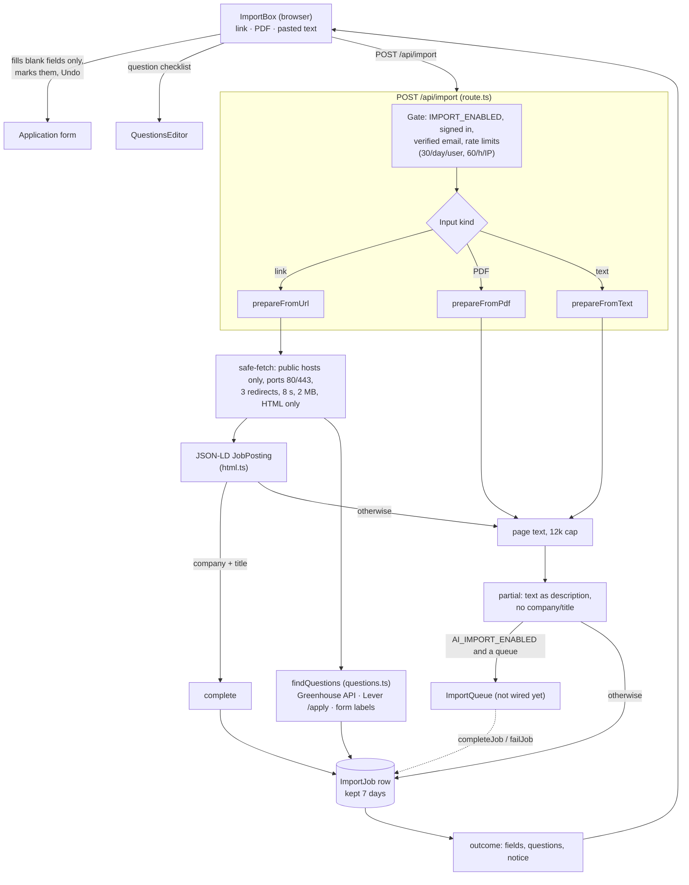

# Job posting importer: architecture

> **Keep this file current.** Any change to the importer (`src/lib/import/`,
> `src/app/api/import/`, `src/components/import-box.tsx`, `src/lib/questions.ts`)
> updates the diagram, the tables and the changelog below **in the same commit**.
> The Cursor rule `.cursor/rules/import-architecture.mdc` reminds you.

The importer turns a link, a PDF or pasted text into values for the Add
application form, and finds the questions the application asks. Everything runs
on the server in `POST /api/import`; the browser only fills in blank fields and
offers Undo.

## Flow

Dotted edges are designed but not built.

## Sources of company and title

| Source | Gives | Used when |
| --- | --- | --- |
| schema.org `JobPosting` JSON-LD | company, title, location, salary, description | the page has one with company and title |
| Page text | description only | everything else |

## Limits and guards

- Fetching: public addresses only (checked at connect time, redirects included), ports 80/443, 3 redirects, 8 s, 2 MB after decompression.
- Questions: best effort, never fail an import, at most 30 offered.
- Jobs: queued jobs expire after 15 minutes, finished jobs are deleted after 7 days, at most 3 pending per person.

## Not built

- AI extraction (Phases 2 to 4): no queue or worker. Blocked on the Inngest install and a worker server.
- JavaScript-rendered boards (Meta, Workable, Workday) return "no readable text".

## Changelog

- Initial version: JSON-LD, page text, questions.
